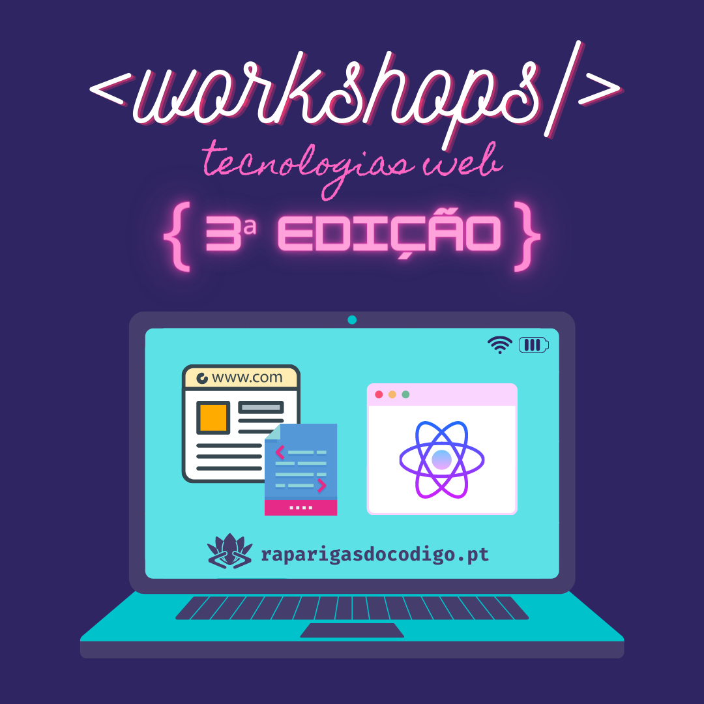

# Introdução às Tecnologias Web (3ª Edição)

---
## Planeamento

| Sessão | Módulo | Tópicos |
| ------------- |-------------|-------------|
|<b>S01</b> 6 Nov | -- | Sessão de abertura. Introdução ao curso. Formato e modo de funcionamento.  Instalação das ferramentas necessárias (e.g., editor de texto, browser).| 
|<b>S02</b> 13 Nov | <b>HTML</b> | Introdução ao HTML.  Tags e estrutura base de uma página web. Tags elementares para apresentação de texto (e.g., cabeçalhos, parágrafos). Atributos de tags. Exemplos mais comuns. Imagens. Links. Bookmarks. Organização de ficheiros. Listas. Tabelas.
|<b>S03</b> 20 Nov | <b>HTML</b> | Formulários. HTML semântico (e.g., `header`, `nav`, `section`).  Atributos `id` e `class`. Elementos `div` e `span`.  Caracteres especiais. Multimédia. Validação de documentos HTML.|   
|<b>S04</b> 27 Nov | <b>CSS</b> |Introdução ao CSS. Sintaxe. Aplicação do CSS.  Heranças de formatação CSS. Tipos de folhas de estilo. Selectores básicos (e.g., tag, class, id). Tipografia. Cores. Posicionamento. Box Model. Fundos. Pseudo-classes e pseudo-elementos. Animações em CSS. Display. Unidades. Media Queries.|
|<b>S05</b> 4 Dez | <b>CSS</b> |Projeto Tutorial: Construção de uma página pessoal / portfólio.|
|<b>S06</b> 11 Dez | <b>JS</b> | Introdução ao JavaScript. Sintaxe. Output e comentários. Instruções condicionais. Instruções iterativas.  Instruções `break` e `continue`. Funções. Eventos.|
|<b>S07</b> 18 Dez | <b>JS</b> | Document Object Model (DOM). Exercícios.|
---

## Bibliografia
- HTML5 & CSS3 for the Real World, 2nd edition. Alexis Goldstein, Louis Lazaris and Estelle Weyl. [[PDF]](https://github.com/Babunashvili/Books-To-Read-Before-You-Die/blob/master/Ebooks/HTML5%20&%20CSS3%20for%20the%20Real%20World%202nd%20Edition.pdf)
- Eloquent JavaScript: A modern introduction to programming, 3rd edition. Marijn Haverbeke. [[PDF]](https://eloquentjavascript.net/Eloquent_JavaScript.pdf)
[[Versão Online]](https://eloquentjavascript.net)
- The JavaScript Way: A gentle introduction to an essential language. Baptiste Pesquet. [[PDF]](https://github.com/thejsway/thejsway/blob/master/thejsway.pdf) [[Versão Online]](https://github.com/thejsway/thejsway)
- Tutoriais da w3schools: https://www.w3schools.com

