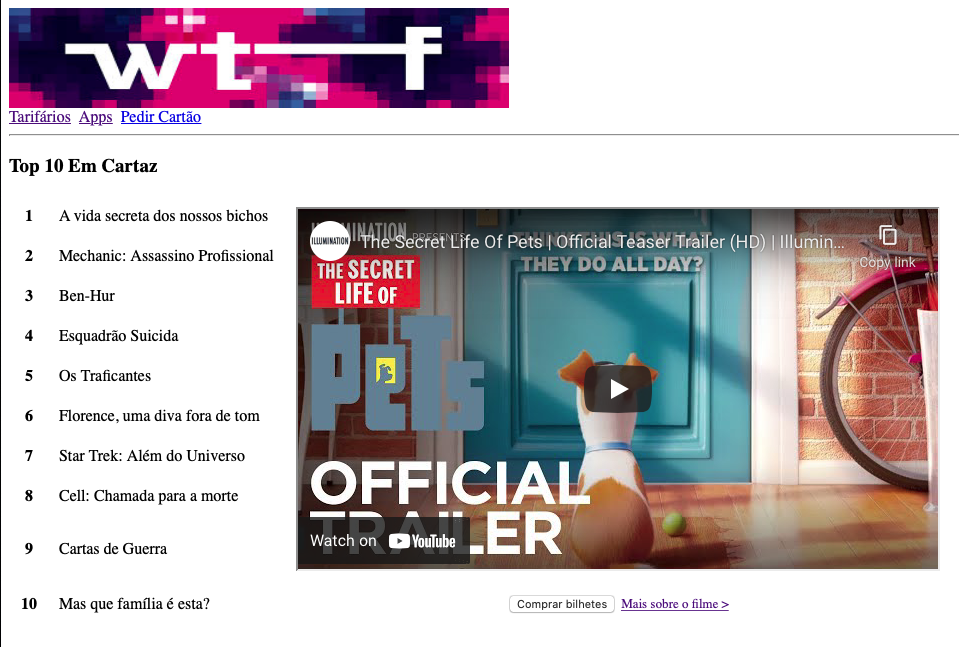

### Passo 4: cinemas.html
Replica a página **cinemas.html**, respeitando todo o conteúdo e layout:

- A página "cinemas.html" deve considerar as mesmas definições internas de CSS que as páginas anteriores. O título da página deve ser "Cinemas WTF";

- O menu de navegação inclui "Tarifários", "Apps" e "Pedir Cartão", com o comportamento já especificado. O comportamento do logótipo deve manter-se;

- O elemento "Top 10 Em Cartaz" é um cabeçalho h3;

- O conteúdo do Top dos filmes, bem como o vídeo, o botão e link para mais informações estão inseridos numa tabela 10x3. A tabela não tem moldura mas tem preenchimento de célula de 10 unidades;

- Os números do top devem estar centrados (e a negrito como se mostra no site);

- O botão "Comprar bilhetes" é um botão normal e não faz parte de nenhum formulário;

- O link "Mais sobre o filme >" tem um caracter especial, e deve abrir numa nova página o site: https://www.fnac.pt/n1006412/Todos-os-Herois-e-Personagens/A-Vida-Secreta-dos-Nossos-Bichos

- O vídeo é inserido usando uma iframe. A localização do vídeo é https://www.youtube.com/embed/i-80SGWfEjM. Deve ter largura de 640 píxeis e altura de 360 píxeis.
