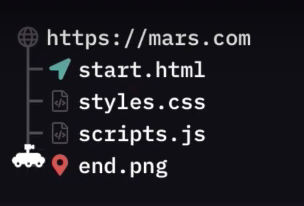
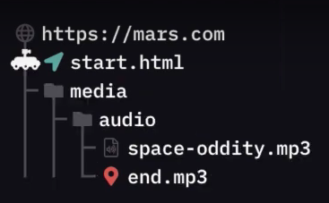
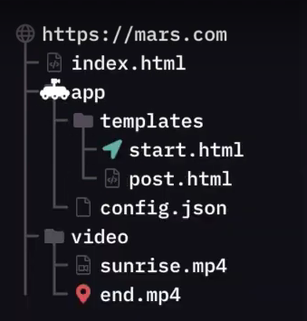

# 🗂 Organização de ficheiros
Quando os nossos projetos começam a evoluir, é normal que a organização dos ficheiros se torne mais complexa! 🤯 

Existem essencialmente duas formas de descrever a localização de um ficheiro:

- Através do seu endereço absoluto: Descreve-se o caminho desde a raíz do computador/servidor até ao ficheiro em causa (é caminho completo para o ficheiro);

- Através do seu endereço relativo: Descreve-se o caminho a percorrer desde a directoria actual até ao
ficheiro;

É muito importante sabermos trabalhar com os endereços relativos dos ficheiros. Caso contrário, qualquer alteração na organização das pastas irá obrigar à alteração do código da localização das imagens, ficheiros html, ou outros objetos (afinal, o seu endereço absoluto muda 😱!). O endereço relativo não muda necessariamente e por isso é preferível usar este tipo de referenciação.

Para usar a referenciação relativa podemos ter em mente duas convenções:

- Para "descer" uma directoria (uma pasta "abaixo"), podemos usar uma barra: `/`

- Para "subir" uma directoria (uma pasta "acima"), podemos usar o seguinte: `../`

E podemos usar quantas vezes forem necessárias! Vamos a uns exemplos? Imagina que foste contratada pela NASA para levar um robô (o Mars Rover) desde um ponto até ao outro, usando apenas endereços relativos.

### Exemplo 1:
Começando por uma missão simples. Como levar o Rover desde o `start.html` até ao 📍 (`end.png`)? 



```html

````

<details>
  <summary>⚠️ Solução (Spoiler)</summary>
  Os ficheiros `start.html` e `end.png` estão na mesma directoria, pelo que apenas precisamos de referenciar a imagem directamente:

  ```html
  
  ```
</details>

### Exemplo 2:
Neste caso, o **end.mp3** está dentro da pasta **audio**, que por sua vez está dentro da pasta **media**.



Para incluíres várias pastas no teu endereço, podes separá-las por barras: `/`

Por exemplo, qual será o endereço relativo desde o `start.html` até ao `end.mp3`?

<details>
  <summary>⚠️ Solução (Spoiler)</summary>

  ```html
  <source src="media/audio/end.mp3">
  ```
</details>

### Exemplo 3:
Qual seria o caminho desde `start.html` até ao `end.mp4`?



<details>
  <summary>⚠️ Solução (Spoiler)</summary>

  ```html
  <source src="../../video/end.mp4">
  ```
</details>

### Créditos
Adaptado do jogo em desenvolvimento em https://codepip.com ♥️