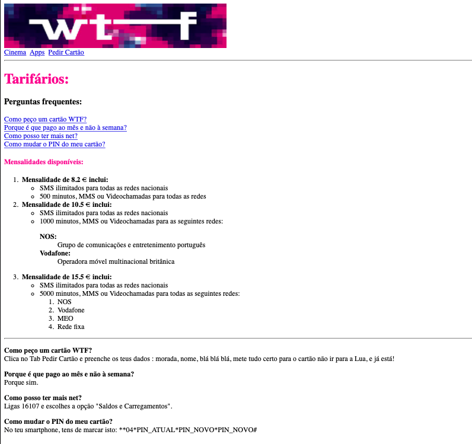

### Passo 1: index.html
Replica a página **index.html**, respeitando todo o conteúdo e layout:

- O título da página "index.html" (no browser) deve ser "WTF". A imagem usada para o logótipo tem largura de 500 píxeis e altura de 100 píxeis. Deve ter uma hiperligação para https://www.wtf.pt que deve abrir num novo separador;

- Deve existir um menu de navegação com as opções "Cinema", "Apps" e "Pedir Cartão", que devem redireccionar o utilizador para as páginas devidas;

- A página começa com um cabeçalho h1 "Tarifários", e um h3 "Perguntas frequentes". As perguntas frequentes têm bookmarks que permitem ao utilizador "saltar" para o fim da página, onde se encontram as respostas. Cada pergunta (cada hiperligação) tem um bookmark para a resposta devida;

- O elemento "Mensalidades disponíveis" é um cabeçalho h4. Os caracteres € e " são considerados caracteres especiais. A informação acerca das mensalidades disponíveis está organizada em listas (ordenadas, não-ordenadas e descritivas);

- As respostas às perguntas (ao fundo da página, abaixo da linha), são parágrafos cujas quebras de linhas e a formatação de texto apresentada devem ser respeitadas.

