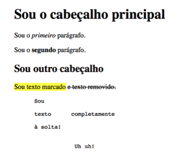
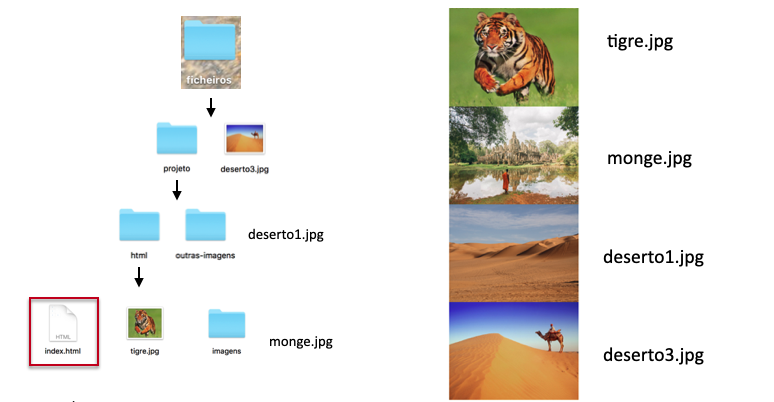
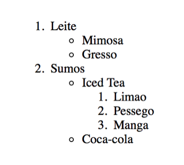
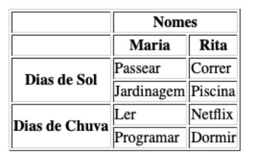
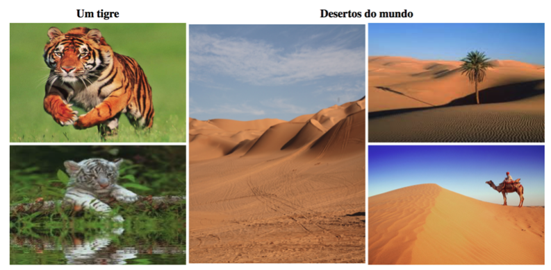
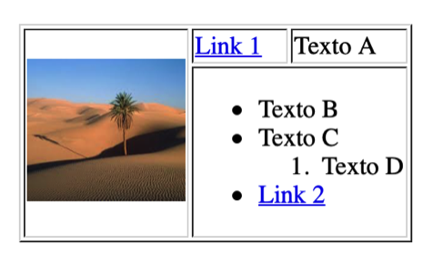

# 📚 S02 - Módulo 1: HTML (Parte 1)
Nesta sessão, vais ser introduzida ao mundo das Tecnologias Web, a começar por aprender HTML! 🤘 

[🗂 S02 - Introdução ao HTML (Parte 1)](ARDC_HTML_Parte_1_Web_3ed_13_Nov_2021.pdf)

## Tópicos:
1. Introdução às Tecnologias Web
2. Introdução ao HTML
3. Elementos básicos
4. Atributos
5. Imagens, Links, Bookmarks
6. Organização de ficheiros
7. Listas
8. Tabelas

## 🙇🏻‍♀️ Exercícios da Aula
### Exercício 1: Formatação de texto
Procura replicar a seguinte página HTML:

### Exercício 2: Organização de ficheiros
Partindo da página `index.html`, e mantendo a organização dos ficheiros estabelecida na imagem, utiliza endereços relativos para mostrar as imagens pretendidas.

Se ainda não dominas bem a organização de ficheiros e a referenciação relativa, [consulta os exemplos indicados aqui!](FILE_PATHS.md) 🤓

### Exercício 3: Listas
Replica a seguinte lista em HTML:

### Exercício 4: Tabelas (1)
Replica a seguinte tabela em HTML:

### Exercício 5: Tabelas (2)
Replica a seguinte tabela em HTML:

### Exercício 6: Tabelas (3)
Replica a seguinte tabela em HTML:

## 🏋🏻‍♂️ Exercícios Pós-Aula 
Precisas de mais exercícios para praticar? Ora essa! Cá estão:

- [[HTML: Formatação de Texto]](https://www.w3schools.com/html/exercise.asp?filename=exercise_html_formatting1)

- [[HTML: Headings]](https://www.w3schools.com/html/exercise.asp?filename=exercise_html_headings1)

- [[HTML: Parágrafos]](https://www.w3schools.com/html/exercise.asp?filename=exercise_html_paragraphs1)

- [[HTML: Comentários]](https://www.w3schools.com/html/exercise.asp?filename=exercise_html_comments1)

- [[HTML: Atributos]](https://www.w3schools.com/html/exercise.asp?filename=exercise_html_attributes1)

- [[HTML: Imagens]](https://www.w3schools.com/html/exercise.asp?filename=exercise_html_images1)

- [[HTML: Links]](https://www.w3schools.com/html/exercise.asp?filename=exercise_html_links1)

- [[HTML: Listas]](https://www.w3schools.com/html/exercise.asp?filename=exercise_html_lists1)

- [[HTML: Tabelas]](https://www.w3schools.com/html/exercise.asp?filename=exercise_html_tables1)

## 🚀 Desafio: Cartão WTF
Aceitas o desafio de construir o teu primeiro website? Vamos lá! 🤘

Neste exercício, tens disponível o ficheiro **index.html** e a pasta **imagens**. A partir desses ficheiros, vais criar um pequeno website. 

### Para começar:
1. Começa por criar uma pasta **wtf** que contenha o ficheiro **index.html** e a subdirectoria **imagens** providenciados;

2. Inspecciona o **index.html**. No início do documento (entre `<head>` e `</head>`), é disponibilizado um pequeno pedaço de código CSS interno. Para que serve?

3. Na directoria **wtf**, cria outra subdirectoria **ficheiros**, onde deves também criar os documentos: **cinemas.html**, **apps.html** e **cartao_wtf.html**.

**Nota:** Os ficheiros criados e as imagens fornecidas não podem mudar de directoria. O objectivo deste exercício é que utilizes a referenciação devida dos ficheiros e imagens, mantendo uma organização de ficheiros adequada.

Segue os passos seguintes para chegares à construção da tua página:

- ✅ [Passo 1: index.html](INDEX.md)
- ✅ [Passo 2: apps.html](APPS.md)
- 🙉 Passo 3: cartao_wtf (próxima sessão - S03)
- ✅ [Passo 4: cinemas.html](CINEMAS.md)

Conseguiste? 😄 Partilha connosco os resultados! Para qualquer dúvida podes sempre consultar a tua mentora ou mentor! 😊

