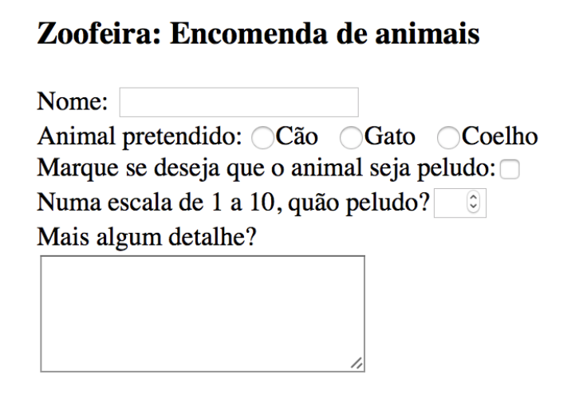
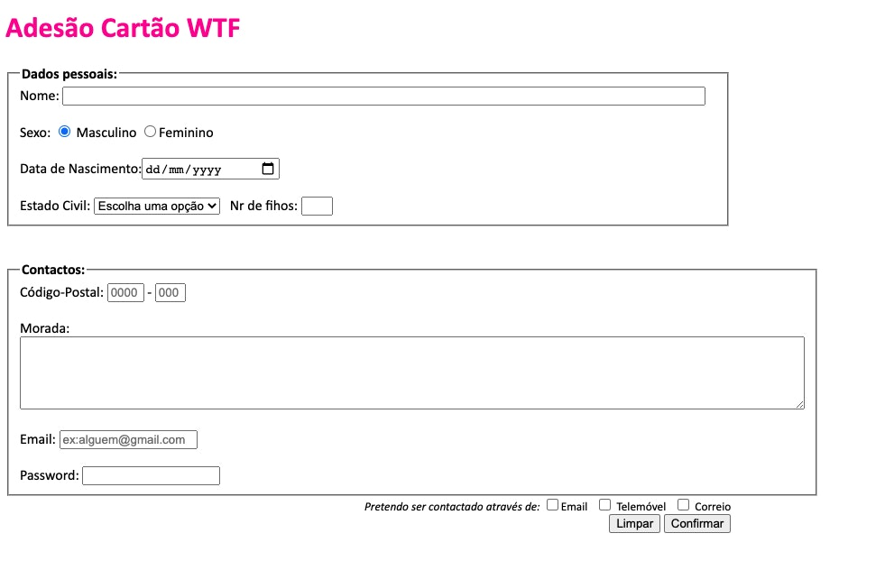

# 📚 S03 - Módulo 1: HTML (Parte 2)
Nesta sessão, vamos terminar o módulo de HTML! 💪

[🗂 S03 - Introdução ao HTML (Parte 2)](ARDC_HTML_Parte_2_Web_3ed_20_Nov_2021.pdf) 

## Tópicos:
1. Formulários
2. HTML semântico
3. Atributos `id` e `class`
4. Elementos `
` e ``
5. Caracteres especiais
6. Multimédia
7. Validação de documentos HTML
8. Introdução básica ao GitHub

## Como publicar um site a partir de um repositório do Github
[Lê este artigo!](Como_publicar_um_site_a_partir_de_um_repositorio_do_Github.md)

## 🙇🏻‍♀️ Exercícios da Aula
### Exercício 1: Formulário Simples
Replica o seguinte formulário:

## 🏋🏻‍♂️ Exercícios Pós-Aula 
Mais exercícios para praticar? Vamos lá!

- HTML: Formulários:
    - [[Formulários]](https://www.w3schools.com/html/exercise.asp?filename=exercise_html_forms1)
    - [[Formulários - Elementos]](https://www.w3schools.com/html/exercise.asp?filename=exercise_html_form_elements1)
    - [[Formulários - Atributos]](https://www.w3schools.com/html/exercise.asp?filename=exercise_html_forms_attributes1)
    - [[Formulários - Input]](https://www.w3schools.com/html/exercise.asp?filename=exercise_html_form_input_types1)

- [[HTML: Atributo id]](https://www.w3schools.com/html/exercise.asp?filename=exercise_html_id1)

- [[HTML: Multimédia (`<iframe>`)]](https://www.w3schools.com/html/exercise.asp?filename=exercise_html_iframe1)

- [[HTML: Parágrafos]](https://www.w3schools.com/html/exercise.asp?filename=exercise_html_paragraphs1)

- [[HTML: Comentários]](https://www.w3schools.com/html/exercise.asp?filename=exercise_html_comments1)

- [[HTML: Atributos]](https://www.w3schools.com/html/exercise.asp?filename=exercise_html_attributes1)

## 🚀 Desafio: Cartão WTF (Formulário)
Neste exercício, vamos terminar a nossa página web "WTF" com a construção do formulário de adesão ao tarifário! ✊ Ou seja, terminando o **Passo 3** do [desafio da aula passada (S02).](../S02-HTML-Parte-1/README.md)

**Algumas regras para a construção do formulário:**

- A página "cartao_wtf" deve considerar as mesmas definições internas de CSS que as páginas anteriores. O título da página deve ser "Cartão WTF";

- Devem ser respeitadas todas as colocações de elementos, alinhamentos, estilos, valores por defeito e agrupamentos mostrados na figura;

- O formulário deve ter uma largura de 70% e existem duas quebras de linha entre cada campo do formulário;

- O campo "Nome" é obrigatório e deve permitir um número infinito de caracteres, mas mostrar apenas 100;

- A "Data de Nascimento" deve poder ser escolhida através de um calendário;

- O "Estado Civil" apresenta as opções {Casado, Solteiro, Divorciado e Viúvo}. A opção "Escolha uma opção" é a opção apresentada por defeito quando a página carrega, mas não deve ser possível selecioná-la na lista;

- O "Nr de filhos" permite valores entre 0 e 5;

- O "Código-Postal" deve ter campos individuais para o indicativo e para a extensão, como mostrado na figura. Ambos devem ser validados: permitir apenas números, 4 algarismos para o indicativo e 3 para a extensão (exemplo: 3040-071). Por defeito, devem ser apresentados os valores "0000" e "000", respectivamente (devem desaparecer quando o utilizador clica no campo, sem ser necessário apagá-los);

- Deve ainda ser adicionada uma "dica/hint/tooltip" para ambos os campos do código-postal, por exemplo "Insira quatro algarismos para o indicativo." e "Insira três algarismos para a extensão.", respectivamente;

- A área de texto do campo "Morada" deve ser definida para 5 linhas e 106 colunas;

- O botão "Limpar" restitui os valores por defeito do formulário e o "Confirmar" é um botão de submissão;

Finalmente, podes validar todos os documentos HTML que escreveste (index, apps, cartao_wtf e cinemas) em http://validator.w3.org  e corrigir eventuais erros ou atualizar os aspetos necessários! 

Parabéns!!! 😁✊ Fizeste a tua primeira página web bastante completa! Agora só falta... partilhares connosco o resultado final através da colocação do teu projeto no GitHub Pages 
([vê aqui como!](Como_publicar_um_site_a_partir_de_um_repositorio_do_Github.md))

E para a semana? Bom, vais aprender CSS que deixará a tua página muito mais bonita, sem dúvida! Continua a partilhar connosco as tuas ideias e modificações ♥️
