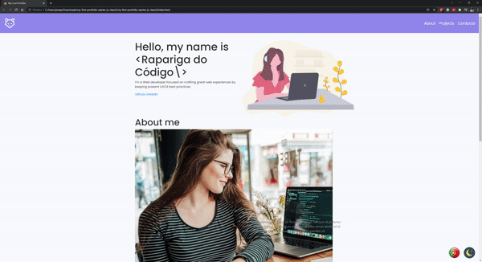
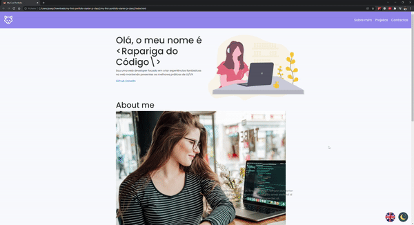

#  JavaScript

Chegámos à última aula do módulo de JavaScript e do workshop de Web!
Após uma aula cheio de teoria, chegou a altura de por o novo conhecimento em prática!

## O que foi abordado na aula?
- DOM - Document Object Model;
- Exercícios
- Adicionar Dark theme ao portfolio

## Desafio para as alunas
- Adicionar traduções ao portfolio

### Dark theme

### Desafio Traduções

